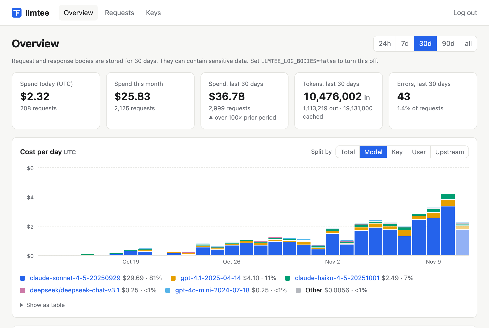

# llmtee

**See what your LLM calls cost. One binary, one file, change the base URL, done.**

llmtee is a self-hosted proxy for the OpenAI and Anthropic APIs (and anything OpenAI-compatible: OpenRouter, Ollama, vLLM, Groq, …). Point your client's base URL at it and every request is logged with tokens, cost, latency and time-to-first-token. Per-key budgets act as an emergency brake and answer with HTTP 429 once a key has spent its daily or monthly limit.

Like the Unix `tee`, it passes every stream through to your client unchanged and keeps a copy.



- **Zero code changes.** It is a proxy, not an SDK. Works with every client that lets you set a base URL: OpenAI and Anthropic SDKs, Claude Code, Codex, automation tools.
- **Zero infrastructure.** A single Go binary with SQLite in WAL mode; backup is copying a file. PostgreSQL is supported if you already run one.
- **Budgets that actually stop spending.** Hard limits per key and day/month, enforced before the request reaches the provider.
- **Local and cloud in one place.** Ollama, vLLM and OpenRouter show up next to OpenAI and Anthropic.
- **Helicone-compatible headers.** Reads `Helicone-User-Id`, `Helicone-Session-Id` and `Helicone-Property-*`, so existing clients keep working ([migration guide](docs/migrating-from-helicone.md)).
- **No lock-in.** CSV export, Prometheus metrics, and an MCP server so agents can query their own spend.

## Quickstart

```sh
docker run -d --name llmtee -p 8080:8080 -v llmtee-data:/data \
  -e LLMTEE_ADMIN_PASSWORD=change-me ghcr.io/garritfra/llmtee
```

Point a client at it. Your provider key passes through unchanged:

```sh
export OPENAI_BASE_URL=http://localhost:8080/openai/v1
export ANTHROPIC_BASE_URL=http://localhost:8080/anthropic
```

```python
from openai import OpenAI
client = OpenAI(base_url="http://localhost:8080/openai/v1")   # api_key from OPENAI_API_KEY
client.chat.completions.create(model="gpt-4o-mini", messages=[{"role": "user", "content": "hi"}])
```

Open <http://localhost:8080> and sign in with the admin password. The request is there, with tokens and cost.

Without Docker: download a binary from the [releases](https://github.com/garritfra/llmtee/releases) (Linux, macOS, Windows; amd64 and arm64) and run `LLMTEE_ADMIN_PASSWORD=change-me ./llmtee`. It creates `llmtee.db` in the current directory.

More setups: [docker-compose.yml](docker-compose.yml), [PostgreSQL compose](deploy/docker-compose.postgres.yml), [systemd unit](deploy/systemd/llmtee.service), [Caddy with TLS](deploy/caddy/Caddyfile).

## Endpoints

| Client base URL | Upstream |
|---|---|
| `http://<host>:8080/openai/v1` | `https://api.openai.com/v1` |
| `http://<host>:8080/anthropic` (SDKs append `/v1`) | `https://api.anthropic.com` |
| `http://<host>:8080/openrouter/v1` | `https://openrouter.ai/api/v1` |
| `http://<host>:8080/u/<name>/v1` | any upstream you configure, e.g. `LLMTEE_UPSTREAM_OLLAMA=http://localhost:11434` |

Usage is extracted from `/v1/chat/completions`, `/v1/responses`, `/v1/embeddings` and `/v1/messages`, streamed or not. Every other path (for example `/v1/models` or audio endpoints) is forwarded too. `GET` requests and Anthropic's `count_tokens` are not logged.

Integration guides: [OpenAI and Anthropic SDKs, Claude Code, Codex, Ollama, OpenRouter, vLLM, n8n](docs/integrations.md).

## Keys and budgets

llmtee supports two key modes, and you can mix them:

- **Passthrough** (default): clients send their own provider key. llmtee forwards it and stores only a SHA-256 hash as the key id (`pt-…`). You can label a provider key in the UI (or with `llmtee keys label`) to give it a name and a budget.
- **Managed**: create a llmtee key (`llmtee-…`) in the UI or with `llmtee keys create NAME`. Clients use it instead of a provider key and llmtee injects the real key from `OPENAI_API_KEY`, `ANTHROPIC_API_KEY`, `OPENROUTER_API_KEY` or `LLMTEE_UPSTREAM_<NAME>_API_KEY`. Teammates and agents never see the provider key.

A managed key can also be sent next to a provider key in a `Llmtee-Key` header (or `Helicone-Auth: Bearer llmtee-…`) to attribute passthrough traffic.

```sh
llmtee keys create hermes-agent --budget-day 5 --budget-month 60
llmtee keys list
```

Budgets are checked in memory before the request is forwarded. A key at or over its limit gets `429` with a readable error in the provider's error format and a `Retry-After` header; the limit resets at the start of the next UTC day or month. Because cost is known only after a response, the request that crosses the limit completes, so a key can overshoot by one request.

Set `LLMTEE_REQUIRE_PROXY_KEY=true` to reject requests without a valid llmtee key.

## Request metadata

| Header | Effect |
|---|---|
| `Llmtee-User-Id` / `Helicone-User-Id` | user id (falls back to the body's `user` or `metadata.user_id`) |
| `Llmtee-Session-Id` / `Helicone-Session-Id` | session id |
| `Llmtee-Property-<Name>` / `Helicone-Property-<Name>` | custom property, filterable in the UI |
| `Llmtee-Omit-Request`, `Llmtee-Omit-Response`, `Llmtee-Omit-Body` (and Helicone equivalents) | do not store that body |

These headers are removed before the request is forwarded. Every response carries `Llmtee-Request-Id`.

## How it works

```
client ──► router ─► auth + budget ─► forwarder ─► upstream
             ▲                          │  (tee)
             └──── stream, unbuffered ──┤
                                        ▼  copy
          usage parser ─► pricing ─► batch writer ─► SQLite / PostgreSQL ─► UI, /metrics, MCP
```

Only routing, the in-memory key and budget check, and forwarding run in the request path. Each chunk is written and flushed to the client immediately; a copy goes to an incremental usage parser. Pricing, budgets, metrics and database writes happen asynchronously in batches (every 500 ms or 100 events). If the database is slow, read-only or gone, requests are still forwarded; events are dropped and counted in `llmtee_events_dropped_total` / `llmtee_db_write_errors_total`.

For OpenAI chat streams llmtee adds `stream_options.include_usage: true` when the client did not, so the stream ends with a usage chunk (disable with `LLMTEE_INJECT_STREAM_USAGE=false`). If a response contains no usage, the request is marked "usage unknown"; llmtee never estimates tokens.

### Cost

```
cost = t_in·p_in + t_out·p_out + t_cache_read·p_cache_read + t_cache_write·p_cache_write
```

`t_in` counts uncached input tokens only (for OpenAI, `prompt_tokens − cached_tokens`). Prices come from [LiteLLM's price table](https://github.com/BerriAI/litellm/blob/main/model_prices_and_context_window.json) (MIT), embedded at build time and refreshed weekly by CI. Anthropic's 1-hour cache writes and long-context tiers are priced separately when the table has them. When OpenRouter reports `usage.cost`, that value is used. Cost is stored with each request, so later price changes do not rewrite history.

Override or add prices in USD per million tokens with a `prices.yaml` (`LLMTEE_PRICES_FILE`):

```yaml
models:
  "llama3.1:8b": {input: 0, output: 0}
  "my-org/*":    {input: 0.5, output: 1.5, cache_read: 0.05}
upstreams:
  ollama: {input: 0, output: 0}
```

## Configuration

All settings are environment variables; a YAML file (`--config` or `LLMTEE_CONFIG`, see [examples/config.yaml](examples/config.yaml)) can hold the same keys. Environment variables win.

| Variable | Default | |
|---|---|---|
| `LLMTEE_LISTEN` | `:8080` | listen address |
| `DATABASE_URL` | `sqlite://llmtee.db` (`/data/llmtee.db` in Docker) | `sqlite://path` or `postgres://…` |
| `LLMTEE_ADMIN_PASSWORD` | random, printed at startup | UI login, metrics and MCP bearer token |
| `LLMTEE_UI_AUTH` | `true` | `false` if a reverse proxy already authenticates |
| `LLMTEE_READ_ONLY` | `false` | read-only UI (demo instances) |
| `LLMTEE_REQUIRE_PROXY_KEY` | `false` | reject requests without a llmtee key |
| `LLMTEE_LOG_BODIES` | `true` | store request and response bodies (zstd-compressed) |
| `LLMTEE_BODY_RETENTION_DAYS` | `30` | delete bodies after N days (0 = never) |
| `LLMTEE_RETENTION_DAYS` | `0` | delete request metadata after N days (0 = never) |
| `LLMTEE_MAX_BODY_BYTES` | `2097152` | bodies are truncated to this size |
| `LLMTEE_REDACT_FIELDS` | | comma-separated JSON field names replaced by `[REDACTED]` before storage |
| `LLMTEE_INJECT_STREAM_USAGE` | `true` | add `include_usage` to OpenAI chat streams |
| `LLMTEE_PRICES_FILE` | | price overrides |
| `OPENAI_API_KEY`, `ANTHROPIC_API_KEY`, `OPENROUTER_API_KEY` | | provider keys for managed llmtee keys |
| `LLMTEE_UPSTREAM_<NAME>` | | add an upstream at `/u/<name>/`, e.g. `LLMTEE_UPSTREAM_OLLAMA=http://ollama:11434` |
| `LLMTEE_UPSTREAM_<NAME>_TYPE` | `openai` | `openai` or `anthropic` API format |
| `LLMTEE_UPSTREAM_<NAME>_API_KEY` | | provider key for managed llmtee keys |
| `LLMTEE_UPSTREAM_<NAME>_LOG_BODIES` | | per-upstream body logging override |
| `LLMTEE_ALERT_WEBHOOK_URL` | | POST a JSON alert when a budget threshold is crossed |
| `LLMTEE_ALERT_NTFY_URL`, `LLMTEE_ALERT_NTFY_TOKEN` | | send alerts to an [ntfy](https://ntfy.sh) topic |
| `LLMTEE_ALERT_THRESHOLDS` | `0.8,1` | fractions of a budget that trigger an alert |
| `LLMTEE_ALERT_GLOBAL_BUDGET_DAY_USD`, `…_MONTH_USD` | | alert on total spend across all keys |
| `LLMTEE_LOG_LEVEL` | `info` | `debug`, `info`, `warn`, `error` |

Upstream names in `LLMTEE_UPSTREAM_<NAME>` must not contain underscores. Setting `LLMTEE_UPSTREAM_OPENAI` (or `ANTHROPIC`, `OPENROUTER`) changes the base URL of a built-in upstream.

## Privacy

Body logging is **on** by default with 30-day retention, because seeing the exact request is half the point. Bodies can contain personal or confidential data. Turn it off globally (`LLMTEE_LOG_BODIES=false`), per upstream, or per request with `Llmtee-Omit-*` headers, and use `LLMTEE_REDACT_FIELDS` for fields you never want stored. Provider keys are never written to the database; only SHA-256 hashes are. llmtee sends no telemetry.

## UI, export, metrics, MCP

- **Web UI** at `/`: spend today/this month with a comparison to the prior period, a cost chart (hourly for 24 hours, daily or weekly for longer ranges, UTC) that can be split by model, key, user or upstream, breakdowns by the same dimensions, budget meters, a filterable request list (upstream, model, key, user, session, status, property) and request details with bodies. Server-rendered with Go templates and htmx; no separate frontend.
- **CSV export**: the *Export CSV* button exports the current filter (`/export.csv`), or run `llmtee export --range 30d > requests.csv`.
- **Prometheus** at `/metrics`: `llmtee_requests_total`, `llmtee_tokens_total`, `llmtee_cost_usd_total`, `llmtee_request_duration_seconds`, `llmtee_time_to_first_token_seconds`, `llmtee_budget_rejections_total`, `llmtee_events_dropped_total`, `llmtee_db_write_errors_total` and more. Send `Authorization: Bearer <admin password>` or use an authenticated UI session.
- **Health** at `/healthz`: always `200` while the proxy runs, with only `{"status":"ok"}` in the body.
- **MCP** at `/mcp` (streamable HTTP, `Authorization: Bearer <admin password>`): tools `get_spend`, `list_requests` and `get_request`. For example, with Claude Code:

  ```sh
  claude mcp add --transport http llmtee http://localhost:8080/mcp --header "Authorization: Bearer $LLMTEE_ADMIN_PASSWORD"
  ```

## Running several instances

With PostgreSQL several llmtee instances can share one database. Budget counters stay in memory per instance and are re-read from the database every 10 seconds, so a key can overshoot its budget by what the instances spend within that window. With SQLite, run a single instance.

## Compared to

| | llmtee | Helicone (self-hosted) | Langfuse | LiteLLM Proxy |
|---|---|---|---|---|
| Integration | base URL | base URL | SDK / OpenTelemetry | base URL |
| Services to run | 1 binary (+ optional Postgres) | several containers | web, worker, Postgres, ClickHouse, Redis, S3 | proxy + Postgres for spend tracking |
| Hard budgets per key | yes | cost-based rate-limit policies via headers | no | yes |
| Status | active | maintenance mode since March 2026 | active | active |
| Scope | logging, cost, budgets | logging, analytics | tracing, evals, prompts | gateway: 100+ providers, routing, fallbacks |

llmtee does one thing. If you need evals, prompt management, routing or fallbacks, use one of the others.

## Limits (on purpose)

- No evals, prompt management, playground, response caching, load balancing, fallbacks, SSO or multi-tenancy. Rule of thumb: if a feature needs a second service, the answer is no or an export.
- Native Gemini, Azure OpenAI and AWS Bedrock APIs are not supported yet (OpenAI-compatible endpoints of these providers work).
- Token counts come from the provider's response. Responses without usage are marked, not estimated.
- Costs are as accurate as the price table. Batch, flex and priority pricing tiers are not modelled.
- The proxy is in the request path. If it is down, your LLM calls fail. Monitor `/healthz` and keep the direct base URL at hand as a fallback.

## Development

```sh
make test          # unit, golden and end-to-end tests (SQLite)
make test-postgres # storage tests against PostgreSQL
make integration   # official Python and TypeScript SDKs against the proxy
make loadtest      # added latency vs. a fake upstream (needs vegeta)
make prices        # refresh the embedded price table
```

Golden tests replay recorded OpenAI and Anthropic streams through the proxy and require byte-identical output; `scripts/record-golden.sh` re-records them from the real APIs. See [CONTRIBUTING.md](CONTRIBUTING.md).

## License

[Apache-2.0](LICENSE). The embedded price data comes from [LiteLLM](https://github.com/BerriAI/litellm) (MIT).
